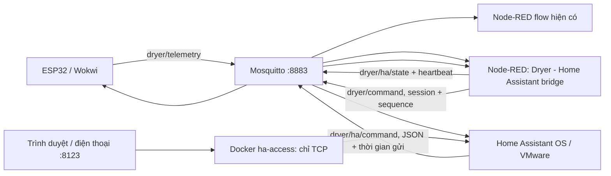

# Home Assistant qua MQTT và Node-RED

## Kiến trúc và quyết định triển khai

Triển khai chính dùng **Home Assistant OS trên VMware**, theo lựa chọn của chủ project. Home Assistant chính thức khuyến nghị HAOS trên máy ảo cho Windows và ghi rõ Docker Desktop không được hỗ trợ cho phương án Home Assistant Container. Vì vậy service `ha-access` trong Compose **chỉ chuyển tiếp TCP**, không chạy Home Assistant Container/Supervised.



Mất Home Assistant/Node-RED/MQTT không tắt tác vụ điều khiển tự động tại ESP32. Cơ chế hành trình, chốt lỗi, đảo chiều, dừng khẩn và timeout vẫn nằm trong firmware. Motor mặc định bị khóa, không bổ sung motor giả hoặc tự gán vị trí từ lệnh.

### Kết quả khảo sát trước khi sửa

- Firmware: `src/main.cpp`; ba lớp logic ở `include/CoverController.h`, `WeatherPolicy.h`, `CommandGate.h`.
- Các topic sẵn có: `dryer/telemetry`, `dryer/command`, `dryer/status`, `dryer/availability`.
- Service: `mosquitto`, `node-red`, `node-red-init`; container hiện có: `iot-mosquitto`, `iot-node-red`.
- Compose project thực tế: `automatic_agricultural_dryer`; network: `automatic_agricultural_dryer_default`.
- Named volume thực tế: `automatic_agricultural_dryer_mosquitto_data`, `automatic_agricultural_dryer_node_red_data`. Broker còn có anonymous volume log cũ, được giữ nguyên.
- Có bản Compose phụ trong `iot-platform/`; không chạy đồng thời với Compose gốc vì trùng cổng/tên container.
- Mosquitto đang dùng `mosquitto/mosquitto.conf`, bắt buộc tài khoản và ACL. Node-RED chỉ bind localhost và yêu cầu đăng nhập; xem [Priority 1](SECURITY_PRIORITY1.md).
- Node-RED đang lưu flow trong volume; flow trên đĩa project không tự ghi đè volume đã có. Khi triển khai đã sao lưu `/data` và thêm riêng tab bridge, giữ các node cũ.
- GPIO giữ nguyên: mưa 34, LDR 35, DHT22 15, hành trình đóng 18/mở 19, LED 23. Ngưỡng 2200/2200/1800 và độ ẩm 70/80% không đổi.
- Thay đổi an toàn có chủ đích: trước đây OPEN thủ công chỉ yêu cầu điều kiện an toàn tức thời; nay **mọi OPEN đều cần đủ 10 giây an toàn liên tục**, đúng yêu cầu tích hợp này. Home Assistant và Node-RED cũng nhận cùng interlock tại ESP32.

## Các thành phần và địa chỉ

| Thành phần | Địa chỉ / lưu trữ |
| --- | --- |
| Mosquitto trong Docker | service `mosquitto`, Windows/LAN port 8883 |
| Wokwi | `host.wokwi.internal:8883`, cần Private IoT Gateway |
| Node-RED trong Docker | `http://localhost:1880`, kết nối broker `mosquitto:8883` |
| Home Assistant OS | VM NAT `192.168.137.50`, HTTP 80, gateway `192.168.137.2` |
| MQTT từ VM | **`192.168.137.1:8883`** (IP host Windows trên VMnet8), không dùng localhost hoặc tên Docker |
| Gateway web | `iot-ha-access`, port Windows 8123 → VM 80 |
| Máy tính | `http://localhost:8123` |
| Điện thoại | `http://192.168.1.4:8123` tại thời điểm triển khai; kiểm tra lại IP Wi-Fi nếu đổi mạng |
| Dashboard | `/dryer-dashboard/overview` |
| Đĩa máy ảo | `%LOCALAPPDATA%\AutomaticAgriculturalDryer\HAOS\` |
| Cấu hình nguồn | `home-assistant/configuration.yaml`, `packages/dryer.yaml`, `dashboards/dryer.yaml` |

IP NAT/LAN trên là giá trị đã khảo sát trên máy này, không phải giá trị dùng chung mọi Windows. `.env.example` chỉ chứa `HA_VM_ADDRESS` và `HA_VM_PORT`; `.env` được Git bỏ qua. Nếu dùng bridged network thay NAT, thay địa chỉ MQTT bằng IP LAN của Windows và đặt `HA_VM_ADDRESS` thành IP mới của VM. Không đổi cổng 8883 của Wokwi.

Home Assistant OS/Core từ 2026.8 mặc định nghe cổng **80**, khác với các hướng dẫn cũ dùng 8123. Gateway của project công khai **8123 chỉ trên máy/LAN**, chuyển vào VM:80. Cấu hình HTTP hiện nằm trong Settings → System → Network; không thêm block `http.server_port` cũ vào YAML. Xem [HTTP settings chính thức](https://www.home-assistant.io/integrations/http/).

Instance mới được khởi tạo bằng tài khoản `dryer-admin`, mật khẩu ngẫu nhiên và token API được lưu tại `%LOCALAPPDATA%\AutomaticAgriculturalDryer\HAOS\access.json`, chỉ cấp quyền file cho tài khoản Windows hiện tại. Mật khẩu không nằm trong Git/OneDrive và không được in vào chat. Mở file này trên máy để lấy mật khẩu, đăng nhập rồi đổi mật khẩu/tên hiển thị theo nhu cầu. File có cả token: không chia sẻ hoặc đưa vào Git. Script `setup-home-assistant.py` dùng onboarding/config-flow API thông thường, không sửa `.storage` và không thay thế tài khoản có sẵn.

## Khởi tạo và quản lý HAOS

`tools/setup-haos-vm.ps1 -Start` tìm bản ổn định mới nhất thực sự có VMware VMDK, tải từ release chính thức và so khớp SHA256. Một số bản HAOS chỉ dành riêng Raspberry Pi nên không lấy mù `releases/latest`. Máy này dùng HAOS 18.4, 2 GB RAM, 2 vCPU, UEFI, card E1000 tương thích VMware 17.5.2; không tắt Hyper-V/WSL hoặc sửa Docker Desktop.

Đĩa VMDK chứa toàn bộ dữ liệu HAOS/Supervisor/Core, tồn tại độc lập với Docker volumes của Windows. Không xóa thư mục VM để "sửa" lỗi.

Đã dùng đĩa CONFIG để cấu hình IP NAT và khóa SSH công khai cho quá trình cài đặt. Khóa riêng nằm trong `.local/haos-debug`, không commit. Không chia sẻ khóa này. Kết thúc triển khai có thể tắt debug SSH theo [hướng dẫn chính thức](https://contributors.home-assistant.io/os/operating-system/debugging/), hoặc giữ trong mạng NAT riêng để bảo trì; không forward cổng 22222 ra LAN/Internet. Tắt SSH trước khi bỏ khóa nếu không còn nhu cầu bảo trì.

### Bật và dừng

PowerShell ở project:

```powershell
# Chỉ bật gateway, không tạo lại Node-RED/Mosquitto đang chạy:
docker compose up -d --no-deps ha-access
docker compose ps -a

# Bật VM đã tạo:
& 'C:\Program Files (x86)\VMware\VMware Workstation\vmrun.exe' start "$env:LOCALAPPDATA\AutomaticAgriculturalDryer\HAOS\dryer-home-assistant.vmx" nogui
```

Dừng Home Assistant bằng Settings → System → menu tắt máy, hoặc `ha host shutdown` trong console HAOS. Chờ shutdown xong trước khi đóng VMware. Dừng gateway riêng: `docker compose stop ha-access`. Dừng gateway không dừng ESP32, Node-RED hoặc Mosquitto. Không dùng `docker compose down -v` và không xóa volume.

Docker Desktop phải chạy khi sử dụng broker/gateway. VM không tự bật sau reboot Windows trừ khi bạn cấu hình VMware autostart. Cấu hình tự bật VM nên làm sau khi nghiệm thu; không thay đổi dịch vụ máy khác trong lần tích hợp này.

## MQTT và Node-RED

### Topic

| Topic | Payload / retain |
| --- | --- |
| `dryer/telemetry` | JSON ESP32, không retain; giữ nguyên |
| `dryer/command` | `<session> <sequence> <STOP/AUTO/OPEN/CLOSE/RESET>`, không retain; giữ nguyên |
| `dryer/status` | Kết quả lệnh/kết nối; giữ nguyên |
| `dryer/availability` | ESP32 online/offline, retained LWT; giữ nguyên |
| `dryer/ha/state` | JSON đã kiểm tra kiểu/range, có vị trí thực tế; không retain |
| `dryer/ha/availability` | Bridge/freshness online/offline; LWT offline; không retain |
| `dryer/ha/heartbeat` | online nếu telemetry mới <10 giây, ngược lại offline; mỗi 2 giây |
| `dryer/ha/command` | JSON `{"command":"OPEN","issued_at":<Unix milliseconds>}`; QoS0, không retain |
| `dryer/ha/command_result` | PENDING/ACCEPTED/REJECTED*/TIMEOUT, session và sequence nếu có; không retain |

Bridge nhận JSON, chuyển số/boolean dạng chuỗi hợp lệ về kiểu chuẩn, kiểm tra ADC 0–4095, nhiệt độ -40–80°C, độ ẩm 0–100%, enum và session/sequence. DHT lỗi chuyển số đo thành null, không phát -999 như nhiệt độ thật. Gói retained hoặc malformed không được dùng để làm mới thời gian online. Firmware cũ thiếu `safe_to_open` sẽ không qua validator: cần build/chạy firmware mới.

Nhập **chỉ** `node-red/home-assistant.flow.json` khi hệ thống đã có flow. File `node-red/flows.json` là export đầy đủ cho volume mới. Script `tools/install-ha-bridge.ps1` dùng API Node-RED v2, sao lưu flow trước sửa, merge theo ID các node do project quản lý và deploy kiểu `nodes`; không xóa node khác hoặc ghi đè toàn bộ volume. Nếu editor đã bật xác thực, đặt `NODERED_ADMIN_TOKEN` trong môi trường hoặc Import bằng UI; không tắt xác thực để chạy script.

Bật Debug node `Dryer HA telemetry / ACK` trong tab mới để xem dữ liệu/ACK. Node mặc định tắt để tránh log dày.

### Lệnh và bảo vệ

- Home Assistant không gửi thẳng lệnh thô vào firmware và không thay đổi cảm biến. Bridge bọc lệnh vào session/sequence hiện hành.
- Lệnh quá 5 giây, timestamp tương lai >2 giây, retained, không hợp lệ hoặc thiếu telemetry mới đều bị từ chối.
- Mỗi giây tối đa một lệnh thường; có một lệnh đang chờ xác nhận thì từ chối lệnh thường khác. STOP được ưu tiên, không bị chặn bởi throttling/busy.
- Hết 5 giây chưa thấy ACK qua telemetry → TIMEOUT. Không tự thử lại lệnh chuyển động. TIMEOUT không chứng minh thiết bị đã dừng; quan sát trạng thái mới và dùng dừng khẩn vật lý.
- ACK xác nhận firmware nhận/chấp nhận hoặc từ chối; **không xác nhận mái đã tới vị trí**. Chỉ hành trình xác nhận vị trí.
- AUTO dùng logic ESP32. MANUAL đưa về STOPPED, sau đó OPEN/CLOSE vào MANUAL_OPEN/MANUAL_CLOSE. STOP giữ dừng; RESET chỉ xóa lỗi về STOPPED.
- OPEN cần khô, sáng, DHT hợp lệ, độ ẩm <70% liên tục 10 giây và không lỗi. CLOSE vẫn đi qua kiểm tra dừng khẩn, driver fault và lỗi hành trình, không bypass các bảo vệ.
- Khởi động lại ESP32 vẫn STOPPED.

## Home Assistant entities

MQTT broker được thêm trong Settings → Devices & services → Add integration → MQTT. Với VM NAT hiện tại: broker `192.168.137.1`, port `8883`, CA custom `.local/security/pki/ca.crt`, bật xác minh chứng thư. Đây là broker Docker hiện có, không cài Mosquitto app/broker thứ hai trong HAOS. Dùng tài khoản riêng `dryer-homeassistant` đã provision; anonymous bị từ chối. Xem [TLS](SECURITY_TLS.md).

Các entity có `unique_id` và `default_entity_id` để ổn định tên lần đầu. Nếu instance đã có entity trùng tên, HA có thể thêm hậu tố: kiểm tra Entity Registry rồi chỉnh lại ID dùng trong dashboard.

| Entity yêu cầu | Nguồn |
| --- | --- |
| `sensor.dryer_temperature` | temperature_c, °C; unavailable khi DHT lỗi |
| `sensor.dryer_humidity` | humidity_pct, %; unavailable khi DHT lỗi |
| `sensor.dryer_rain_adc` | rain_adc |
| `binary_sensor.dryer_rain` | rain |
| `sensor.dryer_light_adc` | light_adc |
| `binary_sensor.dryer_dark` | dark |
| `binary_sensor.dryer_humidity_warning` | dht_valid và humidity >=70 |
| `binary_sensor.dryer_humidity_danger` | dht_valid và humidity >80 |
| `binary_sensor.dryer_dht_valid` | dht_valid |
| `binary_sensor.dryer_limit_closed` | limit_covered |
| `binary_sensor.dryer_limit_open` | limit_open |
| `sensor.dryer_cover_request` | ý định tự động OPEN/CLOSE |
| `sensor.dryer_cover_reason` | nguyên nhân từ firmware |
| `cover.dryer_roof` | Template Cover, trạng thái từ hành trình, điều khiển qua script MQTT |

Bổ sung: `sensor.dryer_roof_position`, `dryer_mode`, `dryer_motion`, `dryer_fault`, `dryer_command_result`; các binary sensor `dryer_online`, `dryer_limit_fault`, `dryer_safe_to_open`, `dryer_estop`, `dryer_driver_fault`, `dryer_motor_active`, `dryer_motor_output_enabled`; các button `dryer_open/close/auto/manual/stop/reset`.

Quy tắc vị trí trên MQTT vẫn là: chỉ đóng active → closed; chỉ mở active → open; cả hai OFF → unknown; cả hai ON → FAULT. Sensor `dryer_roof_position` trên dashboard hiển thị tương ứng **Đã đóng hoàn toàn / Đã mở hoàn toàn / Chưa chạm hành trình / Lỗi hai công tắc** để phân biệt chưa xác nhận vị trí với mất kết nối. Cover lấy trực tiếp hai binary sensor hành trình: cả hai OFF hoặc cả hai ON vẫn unknown, binary limit_fault báo lỗi khi cả hai ON. Không đưa trạng thái OPENING/CLOSING từ state machine thành chuyển động vật lý đã được đo. Khi đầu ra motor khóa, dashboard nói rõ không có chuyển động thật. Cover không optimistic.

`Unavailable` nghĩa là không có dữ liệu hợp lệ mới hoặc bridge mất kết nối; không phải trạng thái bạt. Thời gian "5 minutes ago" ở ô entity có thể chỉ là lần giá trị đổi gần nhất, không phải tuổi của gói MQTT cuối. Khi Wokwi bị pause/tắt hoặc quá chậm, việc báo offline là cần thiết; không tăng timeout để che dữ liệu cũ. Firmware gửi telemetry mỗi 1 giây theo đồng hồ ESP32, DHT22 vẫn đọc mỗi2,5 giây; cần restart mô phỏng/chạy firmware mới để áp dụng.

Sensor/binary sensor MQTT có expiry 12 giây; online có expiry 6 giây và heartbeat 2 giây. DHT lỗi làm nhiệt độ/độ ẩm unavailable ngay theo gói trạng thái. HA restart chờ dữ liệu mới thay vì khôi phục retained sensor cũ. `dryer_command_result` là **kết quả lệnh cuối**, không phải số đo đang diễn ra; thuộc tính có thời gian gửi/hoàn tất.

## Dashboard, lịch sử và cảnh báo

Dashboard đã Việt hóa tên và trạng thái của các hàng hiển thị: có/không mưa, trời sáng/tối, đang dừng, thủ công, nguyên nhân đề xuất, lỗi và kết quả yêu cầu. Các sensor `sensor.dryer_*_text` chỉ dịch để hiển thị; MQTT và các sensor gốc vẫn giữ enum/ID cũ để không làm hỏng automation, lệnh hoặc lịch sử. Các biểu đồ vẫn dùng sensor số gốc, với tên tiếng Việt.

Ô đầu trang xác nhận chế độ đang hoạt động:

- **TỰ ĐỘNG ĐANG BẬT:** thiết bị online và telemetry xác nhận `sensor.dryer_mode = AUTO`.
- **TỰ ĐỘNG ĐANG TẮT:** telemetry xác nhận STOPPED hoặc chế độ thủ công. STOPPED được dịch thành **Đang dừng**.
- **CHƯA XÁC NHẬN CHẾ ĐỘ:** mất kết nối hoặc chưa có mode hợp lệ. Không giữ nhãn bật từ lần trước để gây hiểu nhầm.

`sensor.dryer_auto_status` hiển thị Đang bật / Đang tắt / Chưa xác nhận. `binary_sensor.dryer_auto_enabled` chỉ on khi mode xác nhận là AUTO và unavailable khi thiếu dữ liệu. Nhấn **Bật tự động**, kể cả được ACK ACCEPTED, không tự đổi ô trạng thái trước khi ESP32 gửi mode AUTO. **Đề xuất theo thời tiết** là ý định từ cảm biến, không chứng minh tự động đang bật. Tự động bật cũng không đồng nghĩa motor đang chạy: vẫn phải xét đầu ra motor, hành trình và các interlock.

Sau khi cập nhật YAML, nhấn F5 trang giàn phơi để nhận bố cục mới. Việc Việt hóa này không thay đổi firmware hay điều kiện an toàn.

Dashboard YAML `/dryer-dashboard/overview` dùng card có sẵn, không cần HACS: tổng quan, nhiệt độ/độ ẩm, mưa/ánh sáng, sáu nút điều khiển, hành trình/bảo vệ, biểu đồ 24 giờ và cảnh báo. OPEN và RESET có xác nhận. Recorder lưu 14 ngày cho riêng các entity giàn phơi, commit 10 giây; không thêm cơ sở dữ liệu ngoài. Nếu cần nhiều tháng, cân nhắc InfluxDB sau khi đánh giá dung lượng.

Persistent notification tiếng Việt khi mưa, độ ẩm >=70%, >80%, DHT lỗi, offline, hai hành trình cùng kích hoạt, lệnh bị từ chối hoặc timeout. Mỗi loại có notification_id cố định để tránh tạo vô hạn thông báo. Các thông báo là sự kiện đã xảy ra, có thể cần người dùng dismiss sau khi xử lý; trạng thái hiện tại nằm trên dashboard. Đây chưa phải push notification tới điện thoại: có thể bổ sung `notify.mobile_app_*` sau khi đăng ký Companion App của người dùng.

## Điện thoại và Firewall

1. Windows: chạy `Get-NetIPAddress -AddressFamily IPv4` hoặc `ipconfig`, chọn IPv4 của **Wi-Fi/Ethernet đang dùng**, không chọn VMnet/WSL.
2. Điện thoại và máy Windows cùng LAN, không nằm trên guest Wi-Fi bật client isolation.
3. Mở `http://<IP_LAN_WINDOWS>:8123` trong trình duyệt, đăng nhập tài khoản HA. Có thể cài [Home Assistant Companion App chính thức](https://companion.home-assistant.io/docs/getting_started/) từ App Store/Google Play và nhập cùng URL nội bộ.
4. Nếu localhost được nhưng điện thoại không được: kiểm tra network profile Windows, VPN và Firewall. Máy này có Wi-Fi profile Public; đã tạo rule chỉ cho LocalSubnet/cổng8123 mà không đổi profile. Có thể áp dụng cùng script từ PowerShell Administrator trên máy cần triển khai:

```powershell
powershell -NoProfile -ExecutionPolicy Bypass -File tools/enable-ha-lan.ps1
```

Không tắt toàn bộ firewall, không forward port Internet. Với broker từ VM NAT, nếu bị chặn port 8883, tạo rule riêng giới hạn nguồn subnet VMnet8 `192.168.137.0/24`, thay bằng subnet thực tế của máy. Không thay network profile Public thành Private trừ khi thực sự tin cậy mạng đó.

## Bảo mật và backup

Priority 1 đã được triển khai: tài khoản riêng ESP32/Node-RED/HA, ACL và quản trị Node-RED có xác thực. Xem [cấu hình, credentials và backup](SECURITY_PRIORITY1.md). Hash mật khẩu nằm trong `.local/security/passwords`; cấu hình Compose gốc cũng yêu cầu xác thực, không cần overlay để bật. Không đưa mật khẩu lên command line/history. ACL chỉ cho HA ghi request, không được ghi `dryer/command` hoặc giả telemetry.

Kiểm tra overlay trước khi dùng: `docker compose -f docker-compose.yml -f compose.mqtt-secure.yml config --quiet`. MQTT hiện dùng TLS cổng 8883; các kết nối HTTP giao diện vẫn chưa có TLS. Thay đổi broker có thể gây ngắt MQTT ngắn và cần thực hiện trong lịch bảo trì.

Trước triển khai, dữ liệu Node-RED và cấu hình broker được sao lưu trong `backups/before-home-assistant-*`; mỗi lần merge bridge có `backups/node-red-*`. Những thư mục này được Git bỏ qua và có thể chứa credentials, không chia sẻ công khai.

- HAOS: Settings → System → Backups → tạo backup rồi tải ra nơi khác; giữ encryption/recovery key. Có thể sao lưu **toàn bộ thư mục VM sau shutdown sạch**, không copy VMDK đang ghi. Restore qua onboarding hoặc trang Backups của HAOS.
- Node-RED: Export flows và giữ bản `/data` để bảo toàn credentials/settings; dừng sạch trước khi sao lưu volume cho bản nhất quán. Restore đúng volume ban đầu, không xóa volume để "reset".
- Broker: lưu config, password hash/ACL và volume data nếu cần retained messages. Không khôi phục retained command OPEN/CLOSE.
- Nguồn YAML/flow nằm trong Git; token, password, khóa SSH, `.env`, `.local`, backups không nằm trong Git.

## Xử lý lỗi

| Triệu chứng | Kiểm tra |
| --- | --- |
| VM báo No PCIe slot / crash khi bật | Card E1000 trong script; không dùng lại NIC E1000e thiếu root ports/slot từ VMX tối giản |
| localhost:8123 chuyển sang port 80 | HAOS/Core từ 2026.8 mặc định HTTP 80; gateway phải dùng HA_VM_PORT=80. Cấu hình HTTP mới nằm ở Settings → System → Network, không dùng YAML http cũ |
| Không mở được 8123 | VM đã boot chưa; `docker logs iot-ha-access`; HA_VM_ADDRESS đúng; Docker Desktop chạy |
| MQTT không kết nối | VM dùng IP Windows VMnet8, không dùng localhost/mosquitto; kiểm tra Firewall8883 và credentials |
| Entity unavailable | Có firmware mới với safe_to_open; bridge validator/Debug; telemetry mới <10 giây; HA MQTT integration đã thêm |
| OPEN bị từ chối | Chờ 10 giây khô/sáng/DHT hợp lệ/RH<70; kiểm tra estop/driver/limit fault; RESET không tự chạy |
| Cover unknown | Chưa có công tắc xác nhận; không phải lỗi UI; cả hai ON cần kiểm tra cơ/điện |
| PENDING → TIMEOUT | Không thấy ACK đúng session/sequence trong5 giây; không tự gửi lại; kiểm tra ESP32/Wokwi |

## Kiểm thử và phạm vi xác minh

Chạy `powershell -NoProfile -ExecutionPolicy Bypass -File test/run-host.ps1`: kiểm thử trực tiếp các lớp C++ production và 15 bài Node.js (bao gồm 8 bài bridge HA). Các bài host xác nhận timeout/hành trình/fault/đảo chiều/timer tràn, đủ 10 giây mới mở, validator, vị trí thực tế, TTL, rate limit, ACK và stale. Đây **không phải** kiểm thử motor/Wokwi thực tế.

`python tools/build-home-assistant.py --check` và `node tools/build-flow.cjs --check` xác nhận file sinh khớp nguồn. `ha core check` kiểm tra bằng Home Assistant thật. Xem `docs/HOME_ASSISTANT_VERIFICATION.md` cho kết quả thực thi, phiên bản và ma trận 15 tình huống; không coi các mục chưa chạy là đã đạt.

## Báo cáo theo giai đoạn

1. **Khảo sát:** đọc firmware, hai Compose, hai Mosquitto config, flow nguồn và flow thực tế; xác định network/volume, sao lưu. Không xóa container/volume.
2. **Hạ tầng HAOS:** thêm `setup-haos-vm.ps1`, CONFIG ISO helper, gateway `ha-access.cjs`, Compose ha-access; tạo VM riêng ngoài OneDrive. Bước thủ công khi cần: tài khoản/đăng nhập cá nhân, startup VM sau reboot, Firewall LAN.
3. **MQTT entities/Node-RED:** thêm validator, ha-state/command/watchdog, export bridge riêng; `home-assistant/packages/dryer.yaml` và generator. Tab cũ được giữ lại. Bước thủ công khi chuyển máy: nhập bridge và thêm MQTT integration theo IP host mới.
4. **An toàn:** sửa WeatherPolicy và telemetry thêm safe_to_open; mở thủ công cũng chờ10 giây. Build mới và nạp/chạy firmware trên ESP32/Wokwi là bước người dùng cần thực hiện để thiết bị thực chạy bản này.
5. **Dashboard/cảnh báo:** YAML dashboard, recorder14 ngày, persistent notifications; không yêu cầu add-on frontend. Companion App/push notification cần đăng ký điện thoại thực tế.
6. **Kiểm tra/bàn giao:** C++/Node.js, config check, kiểm tra runtime được ghi riêng; tài liệu backup, bảo mật, LAN và giới hạn. Motor cần nghiệm thu thực tế, không suy diễn từ host tests.

### Tài liệu chính thức

- [Windows / HAOS](https://www.home-assistant.io/installation/windows/)
- [Container và giới hạn Docker Desktop](https://www.home-assistant.io/installation/linux/#install-home-assistant-container)
- [MQTT](https://www.home-assistant.io/integrations/mqtt/)
- [MQTT Sensor](https://www.home-assistant.io/integrations/sensor.mqtt/)
- [Template Cover](https://www.home-assistant.io/integrations/template/#cover)
- [MQTT Button](https://www.home-assistant.io/integrations/button.mqtt/)
- [Recorder](https://www.home-assistant.io/integrations/recorder/)
